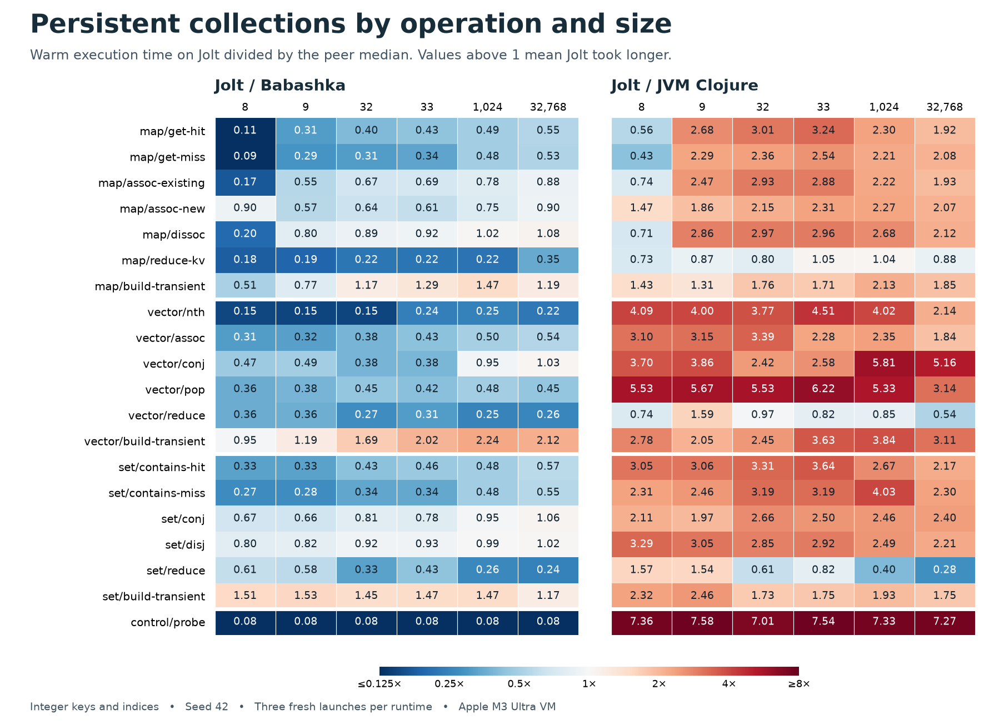

# Persistent collection performance by operation and size

Jolt took longer than both peers on **20 of 114** operation-and-size pairs. **15 of those 20 were transient builds.** JVM Clojure had a lower median than Jolt on 97 pairs. These counts exclude the six probe-only controls and include small differences between medians.



## Where Jolt falls behind

- **Building transient vectors.** At 1,024 elements, Jolt took 15.9 ns per input element, Babashka 7.1, and JVM Clojure 4.1. At 32,768 elements those times were 15.4, 7.3, and 5.0 ns. At both sizes the slowest Babashka and JVM process medians were below the fastest Jolt median. The workload builds with `conj!` from a prebuilt vector, calls `persistent!`, and probes the result.
- **Building transient sets and maps.** Set builds trailed both peers at every size. The largest set gap to Babashka was at 9 elements, with 60.1 ns per element on Jolt versus 39.3 on Babashka and 24.4 on the JVM. Map builds trailed both from 32 elements onward. At 1,024 entries Jolt took 109.6 ns per element versus 74.3 and 51.5.
- **Persistent vector writes against the JVM.** At 33 elements, popping a vector and reading a varying index took 33.4 ns on Jolt, 79.4 on Babashka, and 5.4 on JVM Clojure. Appending to a 1,024-element vector and peeking took 94.5, 99.3, and 16.3 ns respectively. In that append row the Jolt and Babashka process medians overlapped.
- **Map size 8 versus size 9.** A successful lookup went from 12.2 to 22.9 ns on Jolt and from 21.9 to 8.6 ns on the JVM. Inserting one absent key into an eight-entry map was expensive on all three runtimes. For Jolt, insertion plus readback took 397.3 ns starting at eight entries and 96.0 ns starting at nine. Each insertion starts from the original map, so the size-eight row pays the cost of adding a ninth key every time.
- **Reads and traversal.** Map lookup and set membership beat Babashka for both hits and misses at every size. At 32,768 elements, Jolt also led both peers on all three full traversals. Set reduction took 11.3 ns per element on Jolt, 46.3 on Babashka, and 40.7 on the JVM.

## Execution medians

Each cell lists **Jolt / Babashka / JVM Clojure**. Point operations and the control are in **ns per call**, including the probe and checksum loop. The `reduce`, `reduce-kv`, and `build-transient` rows are in **ns per input element**. Bold cells have a Jolt median above both peers. Small differences can fall within the spread of the three launches. The CSV includes every process median and its seven individual timings in milliseconds per batch. [Raw samples](2026-11-10-seed42-collection-sizes-samples.csv)

### Map

| Operation | 8 | 9 | 32 | 33 | 1,024 | 32,768 |
|---|---:|---:|---:|---:|---:|---:|
| `get-hit` | 12.2 / 111.8 / 21.9 | 22.9 / 73.6 / 8.6 | 31.1 / 77.4 / 10.3 | 33.7 / 78.0 / 10.4 | 44.5 / 91.3 / 19.3 | 68.4 / 125.4 / 35.7 |
| `get-miss` | 14.1 / 155.3 / 33.0 | 25.5 / 86.7 / 11.2 | 26.7 / 84.6 / 11.3 | 28.8 / 85.7 / 11.3 | 42.8 / 88.8 / 19.4 | 56.6 / 106.6 / 27.3 |
| `assoc-existing` | 34.4 / 199.9 / 46.2 | 67.5 / 122.1 / 27.3 | 96.1 / 143.8 / 32.8 | 96.8 / 140.1 / 33.6 | 145.7 / 186.5 / 65.6 | 208.6 / 236.7 / 107.8 |
| `assoc-new` | 397.3 / 443.8 / 269.6 | 96.0 / 169.9 / 51.6 | 110.6 / 173.3 / 51.5 | 109.1 / 178.2 / 47.1 | 160.0 / 212.9 / 70.4 | 221.0 / 245.9 / 107.0 |
| `dissoc` | 43.9 / 221.0 / 61.9 | 86.1 / 107.7 / 30.1 | 112.0 / 125.9 / 37.7 | 112.0 / 121.9 / 37.8 | **164.8 / 161.4 / 61.4** | **233.3 / 215.4 / 110.2** |
| `reduce-kv` | 5.6 / 31.0 / 7.7 | 5.9 / 30.6 / 6.8 | 6.6 / 29.8 / 8.3 | 6.5 / 29.7 / 6.1 | 6.7 / 30.8 / 6.4 | 10.6 / 30.0 / 12.1 |
| `build-transient` | 39.5 / 78.0 / 27.6 | 77.8 / 101.1 / 59.2 | **90.5 / 77.4 / 51.4** | **94.8 / 73.4 / 55.3** | **109.6 / 74.3 / 51.5** | **143.3 / 120.1 / 77.6** |

### Vector

| Operation | 8 | 9 | 32 | 33 | 1,024 | 32,768 |
|---|---:|---:|---:|---:|---:|---:|
| `nth` | 8.9 / 58.8 / 2.2 | 8.7 / 59.0 / 2.2 | 8.7 / 58.3 / 2.3 | 15.4 / 63.3 / 3.4 | 15.1 / 61.3 / 3.8 | 17.3 / 77.0 / 8.1 |
| `assoc` | 31.0 / 98.5 / 10.0 | 32.3 / 99.5 / 10.2 | 39.1 / 102.8 / 11.5 | 55.8 / 130.0 / 24.5 | 67.8 / 135.5 / 28.8 | 88.9 / 164.0 / 48.2 |
| `conj` | 36.5 / 77.1 / 9.9 | 37.6 / 77.4 / 9.7 | 36.4 / 95.1 / 15.0 | 30.3 / 78.7 / 11.7 | 94.5 / 99.3 / 16.3 | **117.0 / 113.0 / 22.7** |
| `pop` | 28.9 / 80.8 / 5.2 | 30.7 / 80.1 / 5.4 | 37.3 / 83.3 / 6.7 | 33.4 / 79.4 / 5.4 | 43.6 / 90.1 / 8.2 | 46.3 / 103.3 / 14.7 |
| `reduce` | 6.4 / 17.9 / 8.6 | 6.0 / 16.5 / 3.7 | 3.1 / 11.2 / 3.1 | 3.5 / 11.1 / 4.3 | 2.3 / 9.1 / 2.7 | 2.3 / 8.9 / 4.3 |
| `build-transient` | 23.1 / 24.2 / 8.3 | **26.2 / 22.1 / 12.8** | **18.1 / 10.7 / 7.4** | **22.9 / 11.3 / 6.3** | **15.9 / 7.1 / 4.1** | **15.4 / 7.3 / 5.0** |

### Set

| Operation | 8 | 9 | 32 | 33 | 1,024 | 32,768 |
|---|---:|---:|---:|---:|---:|---:|
| `contains-hit` | 24.1 / 73.2 / 7.9 | 24.2 / 73.9 / 7.9 | 32.4 / 75.5 / 9.8 | 35.4 / 76.6 / 9.7 | 45.1 / 93.2 / 16.9 | 70.4 / 124.3 / 32.4 |
| `contains-miss` | 23.2 / 85.8 / 10.0 | 25.0 / 90.4 / 10.2 | 29.6 / 87.2 / 9.3 | 30.3 / 88.6 / 9.5 | 44.6 / 92.4 / 11.1 | 59.6 / 108.3 / 25.9 |
| `conj` | 113.6 / 168.4 / 53.9 | 117.9 / 177.9 / 59.7 | 138.0 / 171.1 / 51.8 | 137.2 / 176.2 / 54.9 | 198.6 / 208.3 / 80.8 | **261.1 / 246.2 / 108.7** |
| `disj` | 96.2 / 119.7 / 29.3 | 100.7 / 123.5 / 33.0 | 130.1 / 140.7 / 45.7 | 130.1 / 139.8 / 44.5 | 185.6 / 187.1 / 74.6 | **245.9 / 240.3 / 111.4** |
| `reduce` | 14.2 / 23.4 / 9.1 | 13.2 / 22.8 / 8.6 | 9.0 / 27.7 / 14.7 | 11.8 / 27.3 / 14.4 | 9.7 / 36.8 / 24.2 | 11.3 / 46.3 / 40.7 |
| `build-transient` | **60.8 / 40.2 / 26.2** | **60.1 / 39.3 / 24.4** | **73.8 / 50.9 / 42.8** | **74.1 / 50.4 / 42.3** | **91.4 / 62.3 / 47.5** | **127.5 / 109.1 / 72.9** |

### Control

| Operation | 8 | 9 | 32 | 33 | 1,024 | 32,768 |
|---|---:|---:|---:|---:|---:|---:|
| `probe` | 3.6 / 46.0 / 0.5 | 3.6 / 45.4 / 0.5 | 3.6 / 45.2 / 0.5 | 3.7 / 45.3 / 0.5 | 3.6 / 46.9 / 0.5 | 3.6 / 45.3 / 0.5 |

## Startup and measurement conditions

| Median startup and load | Jolt | Babashka | JVM Clojure |
|---|---:|---:|---:|
| Milliseconds per process | 91.3 | 15.9 | 469.3 |

The host was an Apple M3 Ultra VM running arm64 macOS 15.7.3. Jolt was a local release build of `0681cf8b9542`, reporting `v0.8.25-113-g0681cf8b9`. The other runtimes were Babashka 1.12.218 and JVM Clojure 1.12.4 on OpenJDK 25.0.2. The absolute checkout release directory came first on PATH. The project had a dedicated Jolt cache and one preflight launch per runtime before the measured sweep.

The generator used seed 42 and the runner used input 42. Each sample performed 65,536 point operations or `max(1, quot(65536, size))` whole traversals or builds. At 32,768 elements a build sample therefore constructed two complete collections. For each size the generated stride visits every index before repeating. Keys and indices are integers. Maps and vectors store increasing integer values, and sets contain the integer keys. Misses and new insertions use a disjoint range.

Each runtime had three fresh measured processes. Each process loaded the suite once, then ran all 120 profiles, with 10 warmups and seven measured samples per profile. Runtime order rotated and profile order was shuffled for each launch. The figures are medians of the three process medians. All 18,360 warmup and measured batches matched the independent arithmetic oracle. A prior full sweep returned the same checksums and also put transient vector and set builds behind both peers at 1,024 and 32,768 elements.

Startup ends at the flushed readiness marker. Fixture construction and probe generation happen after that marker and before timing. Persistent writes include observing the result. For example, the map removal row deletes a known key and looks it up, and set insertion tests membership in the new set. The control measures array indexing, looping, and accumulation. At size 33 it took 3.7 ns on Jolt, 45.3 on Babashka, and 0.5 on the JVM. The tables report observed time with that overhead included. Other key types, custom hashes, and chains of updates to an evolving root are outside this dataset.

## Reproduce

Run from the repository root with the three runtimes available. The short first sweep populates the project cache.

```sh
make jolt-release
kit="$PWD/benchmarks/generated-project"
work=$(mktemp -d)
export PATH="$PWD/target/release:$PATH" JOLT_CACHE_DIR="$work/jolt-cache"
command -v jolt
bb "$kit/generate.bb" "$work/suite" --seed 42 --collection-sizes 8,9,32,33,1024,32768
(cd "$work/suite" && clojure -Srepro -P -M)
bb "$kit/run.bb" "$work/suite" 42 256 --samples 1
bb "$kit/run.bb" "$work/suite" 42 65536 --warmup 10 --samples 7 --launches 3 --csv "$work/samples.csv"
```

## Cherry-pick note

Cherry-pick `09ccfa2e6720` for the generator, oracle, runner, and tests. The following results commit adds this report, the comparison chart, and the per-launch samples.
